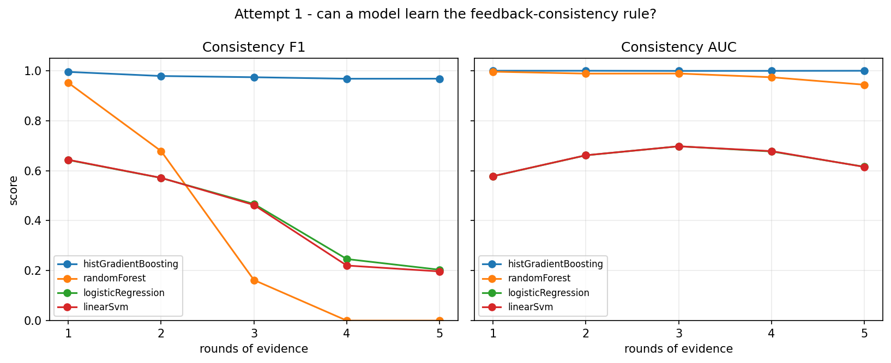

# Wordle Solver — Supervised Candidate-Consistency

A Wordle solver and a supervised-learning experiment built around reusable, tested game
rules. The project asks a learnable question:

> **Given the evidence so far, is this candidate word consistent with every round?**

A model scores all 2,315 possible answers with that binary classifier, and the solver uses those
scores plus the exact feedback rules to play.

## Why this framing

The obvious formulation — 2,315-class classification of the secret word — does not work:

1. A held-out secret is an unseen class; the model can never output it. The measured test accuracy
   was exactly 0%.
2. With a uniformly chosen secret and deterministic feedback, every feedback-consistent candidate
   is equally likely. A classifier can learn the rules but cannot rank the true secret above another
   consistent candidate.

Attempt 1 was therefore reframed to **candidate-consistency scoring**. The full reasoning, data,
features, model comparison and limitations are in
[`src/attempt1/attempt1.md`](src/attempt1/attempt1.md).

## Results

Consistency model on held-out candidate pairs, rounds 1–5:

| Model | Mean F1 | Mean AUC |
|---|---|---|
| Histogram Gradient Boosting | **0.977** | **1.000** |
| Random Forest | 0.358 | 0.978 |
| Logistic Regression | 0.426 | 0.646 |
| Linear SVM | 0.419 | 0.646 |

Solver over 400 held-out games, fixed opener `crane`:

| Picker | Win rate | Avg guesses (wins) |
|---|---|---|
| model + rule mask | 97.8% | 3.91 |
| model-only (no mask) | 95.5% | 3.90 |
| random-consistent | 98.2% | 4.06 |
| fixed-opener + random-consistent | 97.5% | 3.83 |
| random-legal / fixed-word | 0.0% | — |

The learned model recovers the consistency rule, but it does **not** beat the rule-based candidate
filter. That is expected: the posterior is uniform over consistent candidates. The remaining
headroom is strategy, not classification.

Attempt 2 (reinforcement learning) is in progress. **Phases A–C are built**: a Gymnasium
`Env` with legal-action masking, a fixed-width observation, a secret split that keeps 400
answers held out, a reward of +1 for a win minus 0.05 per guess, one measurement harness,
the baseline policies, and three algorithms (REINFORCE, DQN, PPO) trained in PyTorch.

On the 400 held-out secrets, measured by the same harness:

| Policy | Win rate | Avg guesses (wins) |
|---|---|---|
| masked random, fixed opener `crane` | 99.0% | **3.80** |
| **REINFORCE (250k episodes)** | 97.8% | **3.85** |
| Attempt-1 solver (model + rule mask) | 97.8% | 3.90 |
| PPO (150k episodes) | 98.8% | 4.01 |
| masked random | 98.5% | 4.07 |
| DQN (150k episodes) | 95.8% | 4.34 |

So the agent **beats the random baseline and beats Attempt 1**, but it does not beat one
hand-picked opening word. Measured reason: openers differ by 0.46 guesses while a single
game is noisy by about 1.0, so ranking them needs ~100 samples each — ~230,000 episodes
just to sweep the 2,315 openers once.

The `RL stack is pinned in requirements.txt`, and `feedbackTable.py` precomputes every
answer/answer feedback pair once (~5 MB, built lazily) so RL steps are array lookups instead
of Python calls.



## Repository layout

```
src/
├── data/                 # words.txt (14,855 legal guesses), answers.txt (2,315 secrets)
├── wordle/               # shared core
│   ├── feedback.py       # feedback(), candidatesMatching()
│   ├── feedbackTable.py  # cached 2315x2315 feedback table + fast candidate filter
│   ├── vocabulary.py     # cached word lists + stable word <-> index mapping
│   ├── game.py           # GameState, checkGuess, playGameDetailed
│   ├── features.py       # legacy encode, encodeRounds, encodeLetterState
│   ├── dataset.py        # generate, generateVariable, generateClassComplete, evidence helpers
│   └── core.md           # module-by-module core reference
└── attempt1/
    ├── features.py       # 250 candidate-relative features (no label leakage)
    ├── common.py         # data rows, model registry, metrics, artifact persistence
    ├── trainCompare.py   # baselines, training, tables, plot, analysis
    ├── play.py           # interactive / --auto solver
    └── attempt1.md       # full Attempt-1 write-up
└── attempt2/
    ├── config.py         # every Attempt-2 constant (seed, split, reward, observation)
    ├── splits.py         # train / validation / held-out secrets, with a no-leakage assertion
    ├── observation.py    # evidence -> one fixed-width vector
    ├── actionMask.py     # which of the 2,315 answers are still legal to guess
    ├── wordleEnv.py      # the Gymnasium environment
    ├── eval.py           # the one measurement harness every policy is scored with
    ├── baselines.py      # the policies the learned agent has to beat
    ├── smoke.py          # end-to-end smoke test
    ├── policies.py       # the networks, and masked action selection
    ├── rollout.py        # the episode loop all three algorithms share
    ├── replayBuffer.py   # the replay buffer DQN learns from
    ├── reinforce.py      # REINFORCE with a value baseline
    ├── dqn.py            # masked DQN with a target network
    ├── ppo.py            # clipped-surrogate PPO
    ├── train.py          # the training CLI
    └── attempt2.md       # what Attempt 2 is doing, and why
tests/                    # 295 tests
```

## Setup

Python 3.9 virtual environment with the pinned stack in `requirements.txt`, which includes the
Attempt-2 RL stack (`torch`, `gymnasium`):

```bash
python3 -m venv .venv
.venv/bin/pip install -r requirements.txt
```

The data lives at `src/data/`; `vocabulary.py` resolves paths relative to the package.

## Usage

Run the tests:

```bash
.venv/bin/python -m pytest tests/ -q
```

Run the full Attempt-1 experiment (step-3 encoding checks, baselines, four models, comparison
tables, plot, state-level analysis):

```bash
PYTHONPATH=src .venv/bin/python src/attempt1/trainCompare.py
```

Play interactively — you type the first guess, the model plays the rest:

```bash
PYTHONPATH=src .venv/bin/python src/attempt1/play.py
```

Ask for the next best word while you play — you enter each guess and its colours:

```bash
PYTHONPATH=src .venv/bin/python src/attempt1/play.py --advise
```

Colours can be entered as `GYXXG`, `2 1 0 0 2`, or `green yellow grey grey green`. The advisor
validates each move against the evidence and prints the model's next recommended word.

Evaluate the solver and baselines over 400 games:

```bash
PYTHONPATH=src .venv/bin/python src/attempt1/play.py --auto --games 400
```

Test the model without the rule mask (the honest check of what it learned):

```bash
PYTHONPATH=src .venv/bin/python src/attempt1/play.py --auto --model-only
```

`trainCompare.py` writes `model.joblib`, `results.json`, `accuracy.png` and, when the solver is
run, `playResults.json`. The trained model and result files are generated artifacts and are not
tracked.

## Core guarantees

- `feedback()` is pure and handles repeated letters with a green-first, yellow-second pass.
- `candidatesMatching(constraints, loadAnswers())` returns every word consistent with all
  evidence.
- `feedbackTable()` is a pure accelerator: the table is cross-checked against `feedback()`, and
  `candidatesMatchingFast()` returns exactly what `candidatesMatching()` returns. The original
  pure-Python functions are unchanged.
- All imports are package-absolute; run scripts with `PYTHONPATH=src`.
- Naming is camelCase throughout.
- The legacy colour-only `encode` is untouched; the letter-aware `encodeRounds` /
  `encodeLetterState` sit beside it.
- `Dataset.width` derives the expected row width from the stored recipe, and `Dataset.split`
  records whether secrets or evidence were held out.

See [`src/wordle/core.md`](src/wordle/core.md) for the full core contract.
