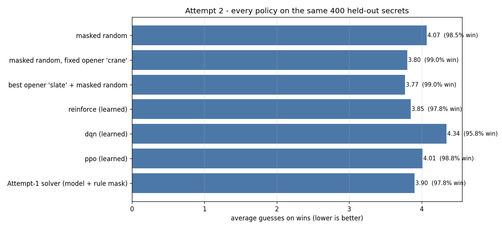

# Wordle Solver — four attempts at a Wordle solver

A Wordle solver built on reusable, tested game rules, and four attempts to solve the game by
different means. Two questions drive it:

> **Given the evidence so far, is this candidate word consistent with every round?**
> **Having narrowed the field with the rules, which word should be guessed next?**

| Attempt | What it is | Status |
|---|---|---|
| 1 | supervised candidate-consistency scoring | ✅ [`attempt1.md`](src/attempt1/attempt1.md) |
| 2 | reinforcement learning — the agent learns a strategy | ✅ [`attempt2.md`](src/attempt2/attempt2.md) |
| 3 | information theory — *compute* the strategy | ✅ [`attempt3.md`](src/attempt3/attempt3.md) |
| 4 | the Module-5 math, written from scratch in NumPy | 📋 `plan.md` §10 |

## Results

### Attempt 1 — supervised candidate-consistency

The obvious framing — 2,315-class classification of the secret — cannot work: a held-out secret
is an unseen class, and with a uniform secret every consistent candidate is equally likely. So
Attempt 1 learned the *rule* instead, and matched the rule-based filter without beating it. The
remaining headroom is strategy.

| Model | Mean F1 | Mean AUC |
|---|---|---|
| Histogram Gradient Boosting | **0.977** | **1.000** |
| Random Forest | 0.358 | 0.978 |
| Logistic Regression | 0.426 | 0.646 |
| Linear SVM | 0.419 | 0.646 |

Solver over 400 held-out games: model + rule mask **97.8%** at 3.91 guesses, random-consistent
98.2% at 4.06, model-only 95.5%, random-legal 0.0%.


### Attempt 2 — reinforcement learning

A Gymnasium environment with legal-action masking, a held-out secret split, +1/−0.05 rewards,
and three algorithms written in PyTorch. On the same 400 held-out secrets:

| Policy | Win rate | Avg guesses (wins) |
|---|---|---|
| best opener `slate` + masked random | 99.0% | **3.77** |
| **REINFORCE** | 97.8% | **3.85** |
| Attempt-1 solver | 97.8% | 3.90 |
| PPO | 98.8% | 4.01 |
| masked random | 98.5% | 4.07 |
| DQN | 95.8% | 4.34 |



The agent beats the random baseline and Attempt 1, but **not one hand-picked word**. An
exhaustive search over all 2,315 openers shows why: `slate` is the best opener (3.779 guesses
against a median opener's 4.050), 144 of the 2,315 are within 0.05 guesses of it — and **PPO
found `slate` from reward alone**.

The most important result is the **generalisation gap**. PPO scores 3.590 on the training
secrets but 4.037 on the held-out ones, no better than random; REINFORCE transfers (3.995 →
3.895). The observation is the feedback history, but the best next guess depends on the set of
still-consistent candidates, which the observation does not contain — so a learned policy can
only memorise the training distribution's average. That is exactly the gap Attempt 3 closes by
*computing* the candidate set.

### Attempt 3 — information theory

The strategy is computed, not learned: the pattern distribution over the still-consistent
candidates, the expected score of each candidate guess, and probes when the information is
worth a guess. On the same 400 held-out secrets:

| Policy | Avg guesses | Win rate |
|---|---|---|
| **C1 expected score** | **3.46** | 100% |
| B1 entropy | 3.46 | 100% |
| C2 two-ply | 3.48 | 100% |
| C1 without probes | 3.53 | 99.2% |
| best Attempt 2 (`slate` + random) | 3.77 | 99.0% |
| best learned agent (REINFORCE) | 3.85 | 97.8% |


That is **0.31 guesses better than Attempt 2's best combination** and 0.39 better than its
best learned agent, with a perfect win rate. Two honest findings: the expected-score term
ties plain entropy (3.46 each, 378 of 400 games identical), and the two-ply lookahead does
not help (3.48). What pays is computing the candidate set exactly and being willing to probe
— removing probes costs 0.083 guesses and 0.8 points of win rate.

### Attempt 4 — planned

`plan.md` §10: the Module-5 exercise — binary candidate-consistency logistic regression in
NumPy, hand-derived gradient `Xᵀ(p − y)/N`, finite-difference and directional-derivative
checks. **No scikit-learn, no PyTorch.**

## Layout

```
src/
├── data/       # words.txt (14,855 legal guesses), answers.txt (2,315 secrets)
├── wordle/     # shared core: feedback, feedbackTable, vocabulary, game, features, dataset
├── attempt1/   # supervised candidate-consistency, solver, attempt1.md
├── attempt2/   # reinforcement learning: env, algorithms, harness, play modes, attempt2.md
└── attempt3/   # information theory: patterns, objective, pickers, lookahead, experiment (+ attempt3.md)
tests/          # 518 tests
```

## Usage

```bash
# tests
.venv/bin/python -m pytest tests/ -q

# Attempt 1: the full experiment, then play it
PYTHONPATH=src .venv/bin/python src/attempt1/trainCompare.py
PYTHONPATH=src .venv/bin/python src/attempt1/play.py            # you type guess 1
PYTHONPATH=src .venv/bin/python src/attempt1/play.py --advise   # you type every guess + colours
PYTHONPATH=src .venv/bin/python src/attempt1/play.py --auto --games 400

# Attempt 2: play it, or measure it
PYTHONPATH=src .venv/bin/python -m attempt2.play                 # you type guess 1, the agent plays on
PYTHONPATH=src .venv/bin/python -m attempt2.play --advise        # the agent proposes, you give colours
PYTHONPATH=src .venv/bin/python -m attempt2.play --auto --games 400
PYTHONPATH=src .venv/bin/python -m attempt2.play --algo ppo      # or reinforce | dqn
PYTHONPATH=src .venv/bin/python -m attempt2.baselines
PYTHONPATH=src .venv/bin/python -m attempt2.experiment

# Attempt 2: train an agent (about 27 minutes for 250k episodes)
PYTHONPATH=src .venv/bin/python -m attempt2.train --algo reinforce --episodes 250000 \
    --learning-rate 0.01 --entropy-start 0.2 --entropy-end 0.01
```

Colours for the advisor modes: `GYXXG`, `2 1 0 0 2`, or `green yellow grey grey green`. The
play modes need a trained agent in `src/attempt2/artifacts/`; if it is missing they print the
command to train one.

## Setup

```bash
python3 -m venv .venv
.venv/bin/pip install -r requirements.txt   # includes torch + gymnasium for Attempt 2
```

## Core guarantees

- `feedback()` is pure and handles repeated letters with a green-first, yellow-second pass.
- `candidatesMatching()` returns every word consistent with all the evidence.
- `feedbackTable()` is a pure accelerator, cross-checked against `feedback()`.
- An illegal action is impossible, not unlikely: the mask is applied before the softmax, so it
  has probability zero and no gradient.
- The held-out secrets are held out *in code*: the environment refuses the wrong pool, and the
  harness refuses to score a policy on the wrong set.
- Package-absolute imports; run scripts with `PYTHONPATH=src`. camelCase throughout.

See [`src/wordle/core.md`](src/wordle/core.md) for the core contract.
