# Attempt 1 — supervised candidate-consistency scoring

**Status:** ✅ complete. The planned Steps 3–10 are implemented and measured; this file records
what was built, why the task was reframed twice, and what the numbers mean.

**Files**

| Piece | Purpose |
|---|---|
| `features.py` | Candidate-relative feature builder (250 features, no label leakage) |
| `common.py` | Data generation, model registry, metrics, artifact persistence |
| `trainCompare.py` | Steps 3–9: baselines, training, tables, plot, disagreement, mistakes |
| `play.py` | Step 10: masked / model-only solver, interactive, `--auto`, and `--advise` modes |

**Artifacts produced**

- `model.joblib` — the best consistency model plus its recipe
- `results.json` — per-model, per-round metrics and state-level analysis
- `accuracy.png` — consistency skill vs rounds
- `playResults.json` — 400-game solver and baseline results

---

## Architecture at a glance

The diagram shows every component of Attempt 1 and the two paths through it: **training** (left
to right, ending at the saved model) and **solving** (bottom, reusing the saved model and the exact
feedback rules).

```mermaid
flowchart LR
    subgraph DATA["Data files"]
        WORDS["src/data/words.txt<br/>14,855 legal guesses"]
        ANSWERS["src/data/answers.txt<br/>2,315 possible secrets"]
    end

    subgraph CORE["src/wordle — shared core"]
        VOCAB["vocabulary.py<br/>loadWords / loadAnswers<br/>answersVocab"]
        FEEDBACK["feedback.py<br/>feedback(guess, secret)<br/>candidatesMatching(evidence, vocab)"]
        GAME["game.py<br/>GameState<br/>checkGuess<br/>playGameDetailed"]
        ENC["features.py<br/>encodeRounds / encodeLetterState<br/>legacy encode"]
        DATASET["dataset.py<br/>splitSecrets / selectTestSecrets<br/>evidenceFor<br/>generateVariable / generateClassComplete"]
    end

    subgraph PREP["src/attempt1 — data preparation"]
        SPLIT["splitSecrets(600, seed=42)<br/>trainSecrets: 600<br/>testSecrets: 400, disjoint"]
        TRAIN_EV["training evidence<br/>evidenceFor(secret, n)<br/>n = 1..5, same games as prefixes"]
        TEST_EV["test evidence<br/>same 400 secrets<br/>fresh sequences"]
        CAND["candidateRows<br/>positives: candidatesMatching(evidence)<br/>negatives: sampled other answers"]
        FEAT["candidateFeatures<br/>250 = 5 rounds x 50<br/>candidate-relative, no feedback label"]
        XY["training matrix<br/>X: 85,350 x 250 float64<br/>y: 0/1, positive rate 0.297"]
        TEST_ROWS["test candidate rows<br/>20 positives + 20 negatives<br/>per state, per round"]
    end

    subgraph TRAIN["Model comparison — trainCompare.py"]
        REG["modelFactories<br/>HistGradientBoosting / RandomForest<br/>LogisticRegression / LinearSVC"]
        FIT["fitModel<br/>one binary model, pooled rounds"]
        METRICS["consistencyMetrics<br/>F1 / AUC / balanced accuracy<br/>threshold per model"]
        TABLE["comparison table + accuracy.png<br/>disagreement table<br/>common false positives/negatives"]
        STATE["state-level scoring<br/>score all 2,315 answers<br/>top-1-consistent / top-1-secret / top-5"]
        ART["model.joblib<br/>best model + feature width<br/>+ metrics"]
        RESULTS["results.json"]
    end

    subgraph SOLVE["Solver — play.py"]
        FIRST["first guess<br/>human prompt or --first crane"]
        PICK["pickWithModel<br/>score candidate pool<br/>masked: candidatesMatching<br/>never repeat a played word"]
        TURN["feedback(guess, secret)<br/>GameState.addGuess"]
        BOARD["render board<br/>win rate / guess counts"]
        ADVISE["--advise mode<br/>human enters guess + colours<br/>model suggests next word"]
        BASE["baselines<br/>random-legal / random-consistent<br/>fixed-word / fixed-opener + random-consistent"]
    end

    WORDS --> VOCAB
    ANSWERS --> VOCAB
    VOCAB --> FEEDBACK
    VOCAB --> DATASET
    DATASET --> SPLIT
    FEEDBACK --> TRAIN_EV
    SPLIT --> TRAIN_EV
    SPLIT --> TEST_EV
    TRAIN_EV --> CAND
    FEEDBACK --> CAND
    CAND --> FEAT
    FEAT --> XY
    XY --> REG
    REG --> FIT
    FIT --> METRICS
    FIT --> STATE
    METRICS --> TABLE
    METRICS --> ART
    STATE --> TABLE
    ART --> RESULTS
    TEST_EV --> TEST_ROWS
    TEST_ROWS --> METRICS
    TEST_EV --> STATE

    FIRST --> PICK
    ART --> PICK
    FEEDBACK --> PICK
    PICK --> TURN
    TURN -->|next turn| PICK
    TURN -->|won / 6 guesses| BOARD
    ART --> ADVISE
    FEEDBACK --> ADVISE
    ADVISE --> PICK
    PICK -.->|suggested word| ADVISE
    ADVISE -->|display history| BOARD
    BASE --> BOARD
    GAME -.-> TURN
    ENC -.->|step-3 encoding checks| TABLE
```



**How to read it.**

- **Data → core:** `vocabulary.py` loads both word lists; `feedback.py` is the only source of truth
  for colours and is reused by every later stage.
- **Training path:** 600 disjoint training secrets → 1–5 rounds of evidence → sampled
  consistent/inconsistent candidate pairs → 250 features each → one pooled binary model.
- **Evaluation path:** the same generator runs on 400 disjoint test secrets with fresh evidence;
  per-row F1/AUC and per-state “can it find a consistent word?” are reported separately.
- **Solve path:** `play.py` loads the saved model, scores a candidate pool, applies the exact
  `candidatesMatching` rule when masked, and feeds the resulting feedback back into the history.
- **Why both a model and a rule mask exist:** the model learns consistency; the mask guarantees the
  solver never plays a word the evidence has eliminated. The two are reported separately
  (model-only vs masked).

**Data shapes at each boundary:**

| Boundary | Shape / type | Meaning |
|---|---|---|
| Word lists | `tuple[str]` | 14,855 legal guesses; 2,315 answers |
| Evidence | `list[tuple[str, tuple[int, ...]]]` | `(guess, pattern)` in play order |
| Candidate row | `list[float]` / `np.ndarray` of 250 | one `(evidence, candidate)` pair |
| Training matrix `X` | `(85,350, 250)` float64 | pooled rounds 1–5 |
| Training labels `y` | `(85,350,)` int | `1` = consistent, `0` = inconsistent |
| Model score | `(n_candidates,)` float | higher = more likely consistent |
| Solver history | at most 5 `(guess, pattern)` pairs | input to the next candidate scoring step |
| Game result | `GameResult(won, guessesUsed, history, secret)` | win / loss and board |

---

## 1. Why this is not answer classification

The original plan trained a 2,315-way classifier to predict the secret word from evidence. That
fails for two separate reasons.

### 1.1 A held-out secret is an unseen class

A classifier can only output classes it has trained on. `generateVariable` split **secrets**
1,500 train / 400 test; the 400 test secrets were not in the model's class list. Measured directly:
logistic regression trained on the original split had **95% train accuracy and exactly 0% test
accuracy** — not because it learned badly, but because none of the test labels existed in its
output space.

Fix: train on **all** 2,315 classes and hold out **evidence**, not words. `dataset.generateClassComplete`
does that, and `dataset.splitSecrets` gives disjoint secrets for the candidate-scoring experiment.

### 1.2 Even with every class, the posterior is uniform

With a uniformly chosen secret and deterministic feedback:

\[
P(\text{secret}=w \mid \text{evidence}) \propto
\begin{cases}
1 & \text{if } w \text{ is consistent with every round},\\
0 & \text{otherwise.}
\end{cases}
\]

The guess policy depends only on past feedback, so it does not break the symmetry. Therefore
**every feedback-consistent candidate is equally likely**. A supervised model can learn
*consistency* — a deterministic rule — but it cannot rank the true secret above another consistent
candidate. Its top-1 secret accuracy is capped at `1 / |consistent set|`.

I verified this before reframing: with a class-complete split, logistic regression reached 95%
train accuracy and 0% held-out accuracy; adding five training sequences per secret still left
held-out top-1 at ~0.25%. The models were memorising the training guess words.

### 1.3 The task that was actually built

Binary, candidate-relative classification:

```
(evidence, candidate word) -> is this candidate consistent with every round?
```

This is learnable, it generalises to unseen secrets (the features do not depend on a class
identity), and it drives a solver. The strategy question — which *consistent* candidate is more
likely, or which next guess maximises information — belongs to Attempt 2 / the deferred entropy
work.

---

## 2. Data

### 2.1 Secrets

- 600 training secrets and 400 **disjoint** test secrets, from `splitSecrets(600, seed=42)`.
- Disjoint secrets are fine here because the model scores candidate words, not secret classes.
- Evidence is generated with the per-secret RNG, so round `n` is a prefix of round `n+1` for the
  same game.

### 2.2 Candidate rows

For each state `(secret, evidence)`:

1. `consistent = candidatesMatching(evidence, answers)` — the exact rule.
2. Sample up to **20 positives** from `consistent`.
3. Sample up to **20 negatives** from `answers \ consistent`.
4. Build one feature row per sampled candidate; label = 1 for consistent, 0 otherwise.

Training pools rounds 1–5 into one matrix: **85,350 rows × 250 features**, positive rate 0.297.
One model therefore serves every turn, just as `encodeRounds` did for the old design.

Sampling is necessary: after one round the consistent set can contain over 1,000 words, while after
five it is usually 1–2. Balanced positive/negative sampling keeps every round learnable.

### 2.3 What "test" means

The 400 test secrets never appear in training, but the model can score any word because the
features are candidate-relative. Test rows are independently sampled candidate pairs from those
states. No evidence row or candidate pair is reused between train and test.

---

## 3. Features (`features.py`)

Width: **250 = 5 rounds × 50 features per round**.

Per played round:

- **5 positions × 4 values:** guess letter index, candidate letter index, observed colour,
  `candidate[pos] == guess[pos]`.
- **5 positions × 6 values:** guess letter index again, candidate count of that letter, guess count,
  number of green/yellow/grey marks for that letter in the guess.

Padded rounds are 50 × `-1`, so the width is constant and the model can tell "not played" from
"played and grey".

Crucially, the feature builder **does not call `feedback(guess, candidate)`**. That call is the
label. The model gets the raw ingredients — positional equality, letter counts, colour counts — and
has to learn the rule. Including the label would make the exercise circular and leak the answer.

What the model must learn, among other things:

```
green at p  => candidate[p] == guess[p]
yellow at p => candidate contains the letter, not (only) at p
grey at p   => candidate has no more copies than the greens already account for
```

The repeated-letter cases are why counts are included: a grey `r` in `error` does not mean `r` is
absent when another `r` is green.

---

## 4. Models

All binary, all on the same 85,350 training rows:

| Model | Settings | Why included |
|---|---|---|
| Histogram Gradient Boosting | 200 iters, lr 0.1, 31 leaves, `class_weight="balanced"` | Strong piecewise learner; the expected winner for a rule with comparisons |
| Random Forest | 200 trees, `balanced_subsample` | Bagged trees; good AUC but poorly calibrated at 0.5 |
| Logistic Regression | `StandardScaler`, `class_weight="balanced"` | Additive linear boundary; tests the interaction caveat |
| Linear SVM | `StandardScaler`, `C=0.1`, `class_weight="balanced"` | Margin-based linear baseline |

No kNN: scoring 2,315 candidates against 85k training rows per turn is not worth it, and the
one-hot/compact distance problem from the old design still applies.

Metrics:

- **F1** on the positive (consistent) class — readable, but sensitive to the shrinking positive rate.
- **AUC** — threshold-free and the fair "did it learn the rule?" comparison.
- **Balanced accuracy** — stored in `results.json` for completeness.
- **State-level:** top-1-consistent, top-1-secret, top-5-secret, mean candidate count, and the
  random-among-consistent reference.

---

## 5. Results

### 5.1 Consistency skill (held-out candidate pairs)

F1:

| Model | n=1 | n=2 | n=3 | n=4 | n=5 | mean |
|---|---|---|---|---|---|---|
| Histogram GB | 0.995 | 0.979 | 0.974 | 0.968 | 0.968 | **0.977** |
| Random Forest | 0.952 | 0.678 | 0.162 | 0.000 | 0.000 | 0.358 |
| Logistic Regression | 0.643 | 0.571 | 0.467 | 0.246 | 0.204 | 0.426 |
| Linear SVM | 0.644 | 0.571 | 0.463 | 0.220 | 0.197 | 0.419 |

AUC:

| Model | n=1 | n=2 | n=3 | n=4 | n=5 | mean |
|---|---|---|---|---|---|---|
| Histogram GB | 1.000 | 1.000 | 0.999 | 1.000 | 1.000 | **1.000** |
| Random Forest | 0.996 | 0.988 | 0.989 | 0.974 | 0.944 | 0.978 |
| Logistic Regression | 0.578 | 0.661 | 0.698 | 0.677 | 0.616 | 0.646 |
| Linear SVM | 0.578 | 0.662 | 0.698 | 0.678 | 0.615 | 0.646 |

**Interpretation.**

- Boosting learned the consistency rule almost perfectly. AUC stays at 1.000 across rounds.
- F1 falls from 0.995 to 0.968 partly because the positive rate falls from 0.477 to 0.096; it is a
  class-imbalance effect, not a collapse in ranking skill.
- The forest has almost the same ranking skill (AUC 0.944 at n=5) but is badly calibrated at the
  default 0.5 threshold: it labels almost nothing positive after three rounds. That is a threshold
  problem; a calibrated cut-off would recover much of the F1. It is also why the solver report
  uses the boosting model.
- The linear models sit near AUC 0.6–0.7. This is the interaction caveat in
  practice: "green at position `i` **and** guessed letter `c` at position `i`" is a joint fact, and
  an additive boundary cannot represent it well. Trees can split on the pair.

### 5.2 State-level ranking (best model, 100 test states per round)

| Rounds | top-1 consistent | top-1 secret | random top-1 | top-5 secret | random top-5 | mean candidates |
|---|---|---|---|---|---|---|
| 1 | 1.000 | 0.030 | 0.041 | 0.100 | 0.136 | 251.1 |
| 2 | 1.000 | 0.250 | 0.197 | 0.510 | 0.501 | 32.7 |
| 3 | 0.950 | 0.480 | 0.427 | 0.830 | 0.791 | 7.9 |
| 4 | 0.900 | 0.620 | 0.678 | 0.940 | 0.930 | 3.4 |
| 5 | 0.860 | 0.670 | 0.770 | 0.950 | 0.983 | 1.9 |

- **top-1 consistent** is the model's real job. It is 100% through round 2 and 86% by round 5.
- **top-1 secret** should track the random-among-consistent column, because the posterior is
  uniform. It does: sometimes slightly above, sometimes below, never far away.
- At round 5 the mean candidate count is 1.9, so even a perfect consistency checker only gets the
  secret about 1/1.9 ≈ 0.53 of the time by prediction alone. The solver's 97.8% win rate comes from
  *accumulating* feedback over turns and eliminating candidates, not from predicting better.

### 5.3 Solver (400 held-out secrets, fixed opener `crane`)

| Picker | Win rate | Avg guesses (wins) | Avg guesses (all) |
|---|---|---|---|
| model + rule mask | **97.8%** | 3.91 | 3.96 |
| model-only (no mask) | 95.5% | 3.90 | 3.99 |
| random-consistent | **98.2%** | 4.06 | 4.10 |
| fixed-opener + random-consistent | 97.5% | 3.83 | 3.88 |
| random-legal | 0.0% | — | 6.00 |
| fixed-word (`crane` every turn) | 0.0% | — | 6.00 |

**Reading this honestly.**

- The learned consistency model does **not** beat the rule-based candidate filter. It cannot: the
  posterior is uniform, and `candidatesMatching` is the exact rule. The model is a learned version
  of a rule we already had.
- The model-only solver is slightly worse (95.5%) because it occasionally ranks an inconsistent
  word first (top-1-consistent 86% at round 5). The rule mask removes that failure mode, giving
  97.8%.
- Random-consistent is 98.2% — a little above the masked model because the tiny model errors cost
  a few games, and because the random baseline's different RNG stream happens to be lucky. The two
  are within noise of each other on 400 games; the important point is that they are the same class
  of solver.
- The fixed-opener + random-consistent baseline (97.5%) shows that most of the win rate comes from
  **using the feedback rules**, not from the classifier. That is the honest headline.
- Random-legal and fixed-word fail completely, so the rules are doing the work.

---

## 6. Why the original learning checkpoints had to change

The original checkpoint expected "accuracy increases as evidence grows (1 → 5 rounds)". For consistency
classification that is not the right expectation: positives become rarer, so F1 can fall while
AUC stays at 1.0. What *does* grow is the solver's win rate as turns accumulate, and the candidate
set shrinks. The revised checkpoints are:

- the model learns consistency (AUC near 1.0) rather than memorising guess words;
- top-1-consistent stays high as rounds grow;
- top-1-secret tracks the random-among-consistent cap, confirming the uniform-posterior argument;
- the solver beats random-legal/fixed-word and matches random-consistent;
- adding a *strategy* (Attempt 2 / entropy probes) is what would beat random-consistent.

---

## 7. How to run

```bash
# full experiment: step 3 checks, baselines, 4 models, tables, plot, artifacts
PYTHONPATH=src .venv/bin/python src/attempt1/trainCompare.py

# interactive: you type guess 1, the model plays the rest
PYTHONPATH=src .venv/bin/python src/attempt1/play.py

# 400-game evaluation
PYTHONPATH=src .venv/bin/python src/attempt1/play.py --auto --games 400

# no rule mask: the honest test of what the model learned
PYTHONPATH=src .venv/bin/python src/attempt1/play.py --auto --model-only

# advisor: you enter every guess AND its colours; the model suggests the next word
PYTHONPATH=src .venv/bin/python src/attempt1/play.py --advise
```

### Advisor mode

`--advise` is the human-in-the-loop mode. You type a guess, then its five colours position by
position; the advisor validates the move against the evidence, shows the remaining consistent
candidate count, and prints the model's next recommended word. It never sees the secret — only the
history you enter.

Accepted colour forms:

```text
GYXGG
2 1 0 0 2
green yellow grey grey green
⬜ 🟨 🟩 ⬜ 🟩
```

An inconsistent guess/colour pair (no answer left) is rejected and not added to the history, so a
typo cannot poison the rest of the session. Type `quit` at any prompt to stop. This is the mode to
use when you want to play a real game yourself but still get a model suggestion each turn.

Runtime on this machine: full training/evaluation about 1–2 minutes; the solver sweep about a
minute.

---

## 8. Limitations and next steps

- **The model cannot rank the secret above other consistent candidates.** That is a theorem about
  the game, not a bug. Do not tune the classifier hoping to beat `1/|consistent|`.
- **The forest is uncalibrated at 0.5.** AUC is high; F1 is misleading. A calibration/validation
  threshold would make the table fairer, but would not change the solver conclusion.
- **Only 600 training secrets.** More would probably not help much, because the rule is simple and
  the HGB model already has AUC 1.0; the bottleneck is candidate ambiguity.
- **The candidate feature set is hand-built.** It deliberately encodes counts and equality but not
  the rule; a learned representation would be a different exercise.
- **No strategy.** The next real improvement is choosing a guess that maximises expected
  information (entropy) or learning a policy (Attempt 2). That is where the remaining win-rate
  headroom is.
- **Play results are 400 games.** Differences of ~1–2 percentage points are within noise; use more
  games if comparing two strategies.

The natural next step is Attempt 2: reinforcement learning, where the agent chooses its own first
guess and can learn *which* consistent candidate/guess to prefer, instead of relying on a uniform
posterior.
