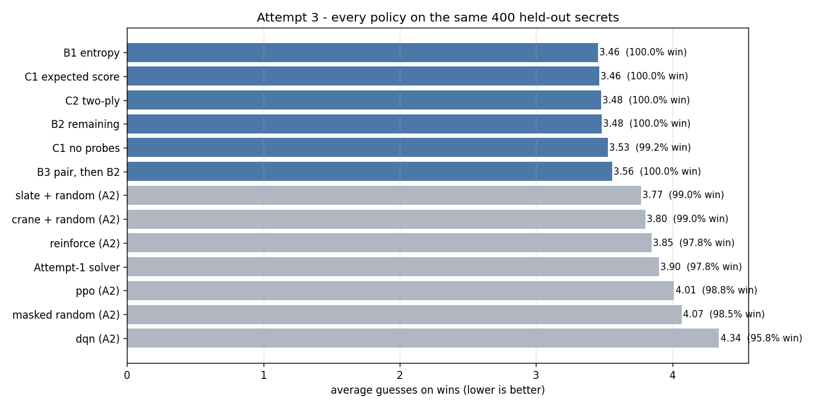

# Attempt 3 — information theory as the strategy

**Status:** ✅ **complete.** All four phases are built and measured, with 211 tests. The
result: **3.46 average guesses and 100% wins on the 400 held-out secrets**, against 3.77 for
Attempt 2's best combination and 3.85 for its best learned agent (§3.10). Two findings the
plan did not predict: the expected-score term ties plain entropy (3.46 against 3.46), and the
two-ply lookahead does not help (3.48). Probes are what pays. This file records the
mathematics, the measurements that decide the design, the criterion the implementation uses,
and what the result actually was.

**It replaces the original Attempt 3** (from-scratch binary logistic regression on the
Module-5 math), which is deferred to Attempt 4. The reasoning: Attempt 2 measured exactly
how much of the remaining strategy headroom is reachable from reward alone, and the answer
was "the opening-word decision is worth about 0.3 guesses, and the signal to find it is
barely above the noise". An attempt that computes the decision instead of learning it
attacks the part of the headroom that the learning-based attempt could not reach.

## Architecture at a glance

Attempt 3 has one loop - *read the evidence, score every playable guess, play the smallest
score* - and two measurement paths that must not be confused: **the gates** decide the design
on the validation slice, and **the experiment** measures the finished policies once on the
held-out 400.

**One turn of one game - the whole policy, top to bottom**

```
        history: [(guess word, five colours), ...]        <- the only input
                          │
                          v
  ┌───────────────────────────────────────────────┐
  │ pickers.stateFor(history)                     │  maskFor() from attempt2,
  │   candidates C = answers consistent so far    │  the same rule the game uses
  │   guesses    = every unplayed answer          │  (probes stay in the pool)
  └───────────────────────┬───────────────────────┘
                          v
  ┌───────────────────────────────────────────────┐
  │ patterns.patternCounts(guesses, C)            │  one gather over
  │   counts[g, p] = n_p                          │  wordle.feedbackTable()
  └───────────────────────┬───────────────────────┘
                          v
  ┌───────────────────────┴───────────────────────┐
  │ A1: H(g)              │ A1: E[|C'|], Jensen   │
  └───────────────────────┬───────────────────────┘
                          v
  ┌───────────────────────────────────────────────┐
  │ A2: score(g) = p + (1 - p) (1 + f(H0 - H(g)))  │
  └───────────────────────┬───────────────────────┘
                          v
  ┌───────────────────────────────────────────────┐
  │ pickers.bestByScore                           │  §2.7 tie-break:
  │   score, then candidate, then E[|C'|], index  │  written once for all pickers
  └───────────────────────┬───────────────────────┘
                          v
                    guess index g
                          │
                          v
       feedbackTable()[g, secret] ──> five colours   (array read, no feedback())
                          │
                          v
                 history += (word(g), colours)
                          │
          ┌───────────────┴───────────────┐
          v                               v
   all five green?                  six guesses used?
          └───────────────┬───────────────┘
                          v
                      game over
```

**The layered modules - what each file is allowed to know**

```
  ┌─────────────────────────────────────────────────────────────┐
  │ wordle/ (unchanged) + attempt2.actionMask                   │
  │   feedbackTable · answersVocab · maskFor                    │
  └───────────────────────────┬─────────────────────────────────┘
                              │  answer *indices*, never words
                              v
  ┌─────────────────────────────────────────────────────────────┐
  │ A1 patterns.py                                              │
  │   histogram -> H(g) · E[|C'|] · Jensen gap                  │
  └───────────────────────────┬─────────────────────────────────┘
                              v
  ┌─────────────────────────────────────────────────────────────┐
  │ A2 objective.py                                             │
  │   expected score, plus the rejected c(m) model              │
  └───────────────────────────┬─────────────────────────────────┘
                              v
  ┌─────────────────────────────────────────────────────────────┐
  │ B0 pickers.py                                               │
  │   feasible set · unplayed pool · deterministic tie-break    │
  └───────────────────────────┬─────────────────────────────────┘
                              v
  ┌─────────────────────────────────────────────────────────────┐
  │ B1 entropy   B2 remaining   B3 pair                         │
  │ C1 expected score           C2 two-ply                      │
  └───────────────────────────┬─────────────────────────────────┘
                              v
  ┌─────────────────────────────────────────────────────────────┐
  │ D1 experiment.py  -> §3.10 + comparison.png + distribution  │
  │ play.py           -> interactive / --advise / --auto        │
  └─────────────────────────────────────────────────────────────┘

  beside the chain, not in it:
    A0 config.py       constants: anchor 11.5, slope 1.5, answers-only, probes on
    A3 letterStats.py  diagnostic: frequencies and the 0.923 correlation (§2.6);
                       the write-up and its tests read it, the pickers do not
```

**The two measurement paths - the split discipline**

```
                   ┌─────────────────────────────────┐
                   │ attempt2.splits (unchanged)     │
                   │   1,915 training secrets        │
                   │   400 held-out secrets          │
                   └───────┬──────────────────┬──────┘
                           v                  v
            200 validation secrets      400 held-out secrets
           (part of the training half)  (unread until Phase D)
                           │                  │
        ┌──────────────────┤                  │
        v                  v                  v
     Gate A             Gate B, Gate C    experiment.py
     every number in    B1/B2/B3,         13 policies, one run
     §2 reproduces      C1 vs no-probe    -> §3.10 + 2 figures
        │                  │                  │
        └────────── decisions fixed here ─────┘
                     (nothing tuned on held-out)
```

**How to read it.**

- **Data goes to the core, not around it.** Attempt 3 adds **no new core code**: it reuses
  `loadAnswers`, `answersVocab`, `feedbackTable` and Attempt 2's `maskFor`, and puts
  everything new under `src/attempt3/`.
- **Everything is an index.** The pipeline passes `int64` answer indices from the vocabulary,
  never strings, so the histogram is one `np.ix_` gather and the score arrays line up with
  the guess array by construction.
- **The histogram is the only expensive step.** One `patternCounts` call per turn scores all
  2,315 guesses; everything after it is arithmetic on a `(k, 243)` array.
- **A3 is a diagnostic, not a policy.** Nothing in the pickers imports `letterStats`; it
  exists to explain *why* the ranking looks the way it does (§2.6), and the write-up is its
  only consumer.
- **The gates and the final table are separate for a reason.** Gates were allowed to change
  the design on the validation slice; the held-out 400 were read once, by policies that were
  already frozen. §3.10 is the only result that may be quoted as held-out.
- **The human interface is the same function.** `play.py` calls the same `pickGuess(history)`
  as the experiment, with the human in either seat: guess first yourself, or report the
  colours of the word the strategy proposes.

**Data shapes at each boundary**

| Boundary | Shape / type | Meaning |
|---|---|---|
| Answer list | `tuple[str]`, 2,315 | the guess set, and the secret set |
| Candidate indices | `np.ndarray`, `(m,)`, int64 | the feasible set C, ascending |
| Guess indices | `np.ndarray`, `(k,)`, int64 | every unplayed answer, probes included |
| Counts | `np.ndarray`, `(k, 243)`, int32 | `n_p`: candidates per colour pattern |
| A1 statistics | `(k,)`, float64 | `H(g)`, `E[|C'|]`, Jensen gap |
| Scores | `(k,)`, float64 | §2.7 expected score, minimised |
| Chosen guess | `int` | an answer index in `[0, 2315)` |
| History | `list[tuple[str, tuple[int, ...]]]` | `(word, five colours)` in play order |
| `PickingState` | dataclass | `candidates`, `guesses` |
| `EvaluationResult` | dataclass | the same harness and shape as Attempt 2 |

---

## 1. Why an information-theoretic attempt

Attempt 1 learned the *rules* of Wordle and could not beat the rule filter, because with a
uniformly chosen secret **every feedback-consistent candidate is equally likely**. Attempt
2 tried to learn a *strategy* from reward alone and reached 3.85 average guesses on the
held-out secrets — better than random-consistent (4.07) and better than the Attempt-1
solver (3.90), but not better than one hand-picked opening word (3.75–3.80).

Attempt 2's own analysis says why, and it is not a bug:

| Quantity | Measured |
|---|---|
| Spread of opener quality across all 2,315 answers | 0.46 guesses (best 3.78, median 4.05, worst 4.61) |
| Noise in a single game's outcome | ~1.0 guesses |
| Openers within 0.05 guesses of the best | **144 of 2,315** (see §3.1 for the correction) |
| Episodes needed to sweep every opener once at ~100 samples each | ~230,000 |

The opening-word decision has a clear target but almost no resolution inside the target
group, so reward-driven learning is a poor tool for it. **Computing** the decision is not:
the entire action space can be searched exactly. And the deeper problem — deciding what to
guess *after* the opener — is a decision problem with an exact objective, not a learning
problem with a noisy one.

That is the case for this attempt: replace the search over strategies with a computation
over strategies.

---

## 2. The mathematics

### 2.1 The setup

Let \(\Omega\) be the answer set (\(|\Omega| = 2315\)) and let the secret be drawn
uniformly, \(P(S = s) = 1/|\Omega|\). After a history \(h = (g_1, p_1), \dots, (g_t, p_t)\)
of guesses and their colour patterns, the **feasible set** is

\[
C(h) = \bigl\{ s \in \Omega \;:\; p(g_i, s) = p_i \text{ for all } i \bigr\}.
\]

The posterior over the secret is **uniform on \(C(h)\)**:

\[
P(S = s \mid h) = \frac{1}{|C(h)|} \quad \text{for } s \in C(h), \qquad 0 \text{ otherwise}.
\]

This is the uniform-posterior theorem from Attempt 1, and it is the single most important
fact in the project: **no method can rank the true secret above another consistent
candidate from the evidence alone.** What can be optimised is *which consistent candidate to
guess*, and *which guess to make in order to shrink the consistent set fastest*.

### 2.2 What a guess carries

A guess \(g\) against a secret \(s\) produces a colour pattern \(p(g, s) \in \{0,1,2\}^5\),
so there are \(3^5 = 243\) possible patterns. Against a feasible set \(C\), write

\[
n_p = \bigl|\{ s \in C : p(g, s) = p \}\bigr|,
\qquad
P(p \mid g, C) = \frac{n_p}{|C|}.
\]

Because the pattern is a deterministic function of the secret, the information the guess
carries is the entropy of its own pattern distribution:

\[
I(g; S \mid C) = H\bigl(P(\cdot \mid g, C)\bigr)
= -\sum_{p} \frac{n_p}{|C|} \log_2 \frac{n_p}{|C|}
\quad \text{bits}.
\]

**Read this carefully, because the sign is easy to say backwards.** \(H\) is the entropy of
the **feedback distribution**, not of the word and not of the candidate set. A *high* \(H\)
means the colours are hard to predict, i.e. the guess separates the candidates into many
similarly sized groups, so it carries a lot of information. A *low* \(H\) means the colours
are nearly the same whatever the secret is: a nearly useless guess. **We maximise \(H\).**

What we want to be *small* is the uncertainty that remains after the guess. In expectation:

\[
\mathbb{E}\bigl[\,|C'| \mid g, C\,\bigr]
= \sum_{p} \frac{n_p}{|C|}\, n_p
= \frac{1}{|C|} \sum_{p} n_p^{2}.
\]

The two are linked **exactly** through the logarithm:

\[
\mathbb{E}\bigl[\log_2 |C'| \,\big|\, g, C\bigr] = \log_2 |C| - H(g).
\]

That is an identity, not an approximation. The expected *size* \(\mathbb{E}[|C'|]\) is not
\(2^{\log_2|C| - H(g)}\), because the logarithm is concave; the difference is the Jensen
gap of §2.3. What matters for the strategy is the identity: maximising the guess's pattern
entropy is the same as minimising the expected log of the remaining candidate set. "Pick the
word with the least entropy" would pick the *least* informative guess.

For the best opener by information, `raise`:

\[
H = 5.878\ \text{bits}, \qquad \mathbb{E}[|C'|] = 61.0,
\qquad \text{non-empty branches} = 132, \qquad \text{largest branch} = 168.
\]

So the root splits 2,315 secrets into 132 groups, and the largest group (the all-grey
branch) still has 168 possible answers.

### 2.3 The two criteria are related but not the same

Write \(m = |C|\). Since \(H = \log_2 m - \mathbb{E}[\log_2 n_p]\) and \(\log_2\) is
concave, Jensen's inequality gives

\[
\mathbb{E}[\log_2 n_p] \le \log_2 \mathbb{E}[n_p],
\]

and therefore

\[
H \ge \log_2 \frac{m}{\mathbb{E}[n_p]}.
\]

The **Jensen gap** is the distance from \(H\) to that lower bound:

\[
\underbrace{H - \log_2 \frac{m}{\mathbb{E}[n_p]}}_{\ge 0}
= \log_2 \mathbb{E}[n_p] - \mathbb{E}[\log_2 n_p] \ge 0.
\]

It is zero when every non-empty branch has the same size, and grows as the branch sizes
become more unequal. For `slate`:

\[
H = 5.8558\ \text{bits}, \qquad
\mathbb{E}[|C'|] = 71.57, \qquad
\log_2 \frac{2315}{71.57} = 5.0155\ \text{bits},
\]

so the Jensen gap is **0.8403 bits**. Two openers with the same entropy can have very
different expected remaining counts, and vice versa — which is why the two criteria produce
different rankings (measured in §3.2).

> **Correction.** An earlier version of this section claimed \(H \le \log_2 \mathbb{E}[n_p]\)
> and called the signed difference \(\log_2 \mathbb{E}[n_p] - H\) the "Jensen gap" (0.31
> bits for `slate`). That inequality is backwards, and the signed difference can be
> negative: for two equal branches \(H = 1\) and \(\mathbb{E}[n_p] = 1\), so it is \(-1\).
> The gap implemented in `patterns.py` is the non-negative quantity above. For `slate`,
> \(\log_2 \mathbb{E}[n_p] - H = 0.3056\), which is *not* a Jensen gap.

### 2.4 The bit budget

\[
\underbrace{\log_2 |\Omega|}_{\text{the secret}} = \log_2 2315 = 11.18 \ \text{bits},
\qquad
\underbrace{\log_2 243}_{\text{one guess, at best}} = 7.92 \ \text{bits}.
\]

One guess cannot carry the secret (7.92 < 11.18). **Two guesses can** (15.85 > 11.18) —
but only on paper; see §3.4 for why the word constraint eats that.

The best opener actually extracts **5.88 bits**, i.e. 53% of the secret, and no guess
achieves more than 7.92. The remaining 5.3 bits have to come from later guesses, each of
which sees a smaller and therefore less informative feasible set.

### 2.5 The six-guess objective — useful as a model, not as the decision rule

The game ends after six guesses. If a guess leaves a feasible set of size \(m\), and the
remaining guesses are made uniformly at random among the consistent candidates, the number
of further guesses needed is \(\mathbb{E}[\min(T, 5)]\) with \(T\) uniform on
\(\{1, \dots, m\}\):

\[
c(m) = \mathbb{E}[\min(T,5)] =
\begin{cases}
\dfrac{m+1}{2} & m < 5 \\[6pt]
5 - \dfrac{10}{m} & m \ge 5
\end{cases}
\]

and the expected number of guesses for an opener \(g\) is the concave functional

\[
\mathbb{E}[\text{guesses}] = 1 + \sum_{p} \frac{n_p}{|C|}\; c(n_p).
\]

**This concavity is real and it explains the disagreement between criteria.** For \(m \ge 5\),
\(c(m) = 5 - 10/m\) is concave and increasing, so the marginal cost of another candidate in
a big branch is small: those games are lost either way. An opener that produces **many tiny
branches and one huge branch** is therefore better than one that produces a flat spread,
*even if the flat spread has more information*. Entropy rewards flatness; this objective
rewards the other shape.

#### 2.5.1 Measured: why the objective is not the decision rule

**Revised at Gate A.** The functional is now implemented (`expectedGuesses` in
`objective.py`) and was re-measured over all 2,315 answers. Two claims from the first draft
of this section did not survive that measurement; the corrected statements are below. The
decision itself is unchanged: the functional stays as a tested, documented model, and the
picker uses the expected-score criterion of §2.7.

1. **It ranks the openers differently, but not in the direction the draft claimed.**
   Minimising the functional ranks `trace` 1, `slate` 2 and `raise` 18 - that part of the
   draft holds. It does **not** put `fuzzy`, `vivid` and `mummy` at the top: measured over
   all 2,315 answers they rank **2,314, 2,303 and 2,306**. The concavity argument above is
   correct, but the cap saturates a huge branch at 5 further guesses, so skew is expensive
   in expectation rather than cheap. Over the whole answer list the functional correlates
   with entropy at **0.95** (Spearman; top-20 overlap 11/20), so at the root the two
   criteria are close cousins, not opposites.
2. **The 0% win rate belongs to the uncorrected formula.** The greedy rule that never
   guessed the answer was the *naive* version, before the all-green branch was made free -
   which is exactly the correction the paragraph above calls for. With the correction the
   singleton case strictly prefers the answer (score 1, against 2 for a probe), so the loss
   rate of the corrected model is **not established**. What the correction does not fix is
   the last turn.
3. **It is indifferent on the last turn.** With one guess left, a win and a loss both cost
   one more guess under the cap, so the objective cannot distinguish them. This is the
   failure that survives the correction, and it is why the criterion needs the win-chance
   term of §2.7 regardless of how well it ranks openers.

The cap is the root cause, but in the opposite direction to the first draft: because
\(c(m) \le 5\), every branch larger than a handful of words costs nearly the same, so the
functional cannot separate two good openers in the way that matters and ends up tracking
entropy. What it does not add is anything on the last turn, where a win and a loss cost the
same. A correct version also has to give the all-green branch a further cost of **0** (the
naive formula overcounts by \(1/|C|\); small for the opener, but wrong in general).

**Conclusion:** the \(c(m)\) functional stays in `objective.py` as a documented, tested
model — it is the clearest statement of what the six-guess cap does to the cost of a branch
— but the picker uses the expected-score criterion in §2.7, which can win immediately and
can tell the last turn from the one before it.

### 2.6 Why the letter-level theory works

Two effects, both measured:

**Distinct letters.** A guess with a repeated letter cannot distinguish as many outcomes,
because the colours of the repeated letter are constrained by the counts of that letter in
the secret. Measured mean pattern entropy:

| Distinct letters in the guess | n | Mean entropy |
|---|---|---|
| 2 | 1 | 2.40 bits |
| 3 | 57 | 3.41 bits |
| 4 | 691 | 4.12 bits |
| 5 | 1,566 | **4.77 bits** |

**Common letters.** Among the 1,566 words with five distinct letters, the correlation
between the guess's mean letter frequency and its pattern entropy is **0.80** in the earlier
note; re-measured on this project's list it is **0.923** (see §7).

Together these explain the empirical ranking without any search: the best openers are
permutations of the commonest letters. The measured average-guess top twenty are built from
\(\{a, e, t, l, s, c, r, n, p\}\), and six of them (`slate`, `least`, `slant`, `stale`,
`dealt`, `leant`) are permutations of the *same five letters* — because **the information
in an opening word is in which common letters it tests, not in their arrangement**. Note
that the *entropy* top twenty is a different list and does contain `d`, `i` and `o`; §7
records the correction.

**Implemented and verified.** `letterStats.py` computes all of this, and
`tests/test_attempt3LetterStats.py` pins the table above bucket for bucket and the 0.923. One
definition is forced by that number: "letter frequency" counts every **occurrence**, so the
two `b`s of `abbey` both count. Counting each letter once per word instead gives 0.9365, not
0.923. The frequency proxy on its own is won by `eerie` — the highest mean letter frequency
in the answer list and a poor opener — which is exactly why the correlation is restricted to
the five-distinct-letter subset.

### 2.7 The criterion used: expected score

Maximising entropy is the right *information* objective, but it is not quite the right
*game* objective: it ignores the fact that a guess can win immediately, and it ignores the
six-guess cap. A guess that is nearly as informative but could end the game now should
sometimes beat a slightly more informative probe.

The policy therefore minimises an **expected-score** criterion. For a feasible set \(C\)
with \(m = |C|\) and a uniform posterior:

- the current uncertainty is \(H_0 = \log_2 m\);
- the guess's pattern entropy is \(H(g)\), from §2.2;
- the information it leaves behind is \(H_0 - H(g)\);
- the chance it wins immediately is

\[
p(g) = \begin{cases} 1/m & g \in C \\ 0 & g \notin C \end{cases}
\]

and the score is

\[
\boxed{
\operatorname{score}(g) = p(g) + \bigl(1 - p(g)\bigr)\Bigl(1 + f\bigl(H_0 - H(g)\bigr)\Bigr)
}
\]

with

\[
f(x) = 2^{-x} + 2\bigl(1 - 2^{-x}\bigr) + \frac{1.5\,x}{11.5}.
\]

The guess with the **smallest** score is played.

**What each term means.**

- \(p(g)\): if the guess is the secret, the game ends now, and the total cost is 1.
- \(1 + f(H_0 - H(g))\): otherwise the guess costs one, and \(f\) estimates how many more
  guesses the *remaining* uncertainty implies, in the same units.
- \(f(0) = 1\): if the guess leaves no uncertainty and it was not the answer, exactly one
  more guess is needed to name the answer.
- \(f(11.5) \approx 3.50\): a full board's worth of uncertainty is calibrated to about 3.5
  further guesses. The \(2^{-x}\) and \(2(1-2^{-x})\) terms are the one-guess and two-guess
  contributions of a uniform set of size \(2^x\); the linear term calibrates the tail.
  The constants `11.5` and `1.5` are **fixed before any evaluation** and are not tuned on
  the held-out secrets (a sensitivity check belongs on the validation slice).

**Why probes are necessary.** For a candidate, \(p = 1/m\); for a probe, \(p = 0\). A
candidate with slightly less information can beat a probe because it can win now. If the
guess set is restricted to \(C\), then \(p = 1/m\) for *every* guess, the \(p\) term is
constant, and the criterion collapses to "maximise \(H(g)\)" — plain entropy, with none of
the endgame reasoning. Probes are what give the criterion something to trade off.

**Two worked examples.**

- Two candidates left. Guessing one: \(p = 0.5\), \(H = 1 = H_0\), so
  score \(= 0.5 + 0.5(1 + f(0)) = 1.5\). A probe that splits them 1–1:
  \(p = 0\), score \(= 1 + f(0) = 2.0\). The candidate wins, correctly: guessing it takes
  1 guess half the time and 2 the other half, average 1.5; the probe always takes 2.
- 100 candidates, \(H_0 = 6.64\). A probe with \(H = 6\): score
  \(= 1 + f(0.64) \approx 2.44\). A candidate with \(H = 1\):
  \(p = 0.01\), score \(\approx 0.01 + 0.99(1 + f(5.64)) \approx 3.69\). The probe wins.

**Ties.** The score is a float; exact ties are rare. The deterministic tie-break is:
prefer a candidate, then the smaller expected remaining count, then the lower index. This
is bookkeeping, not part of the information criterion.

### 2.8 From the criterion to a decision tree

A Wordle strategy **is** a decision tree:

- a **node** is a feasible set \(C\) plus the words already played;
- an **edge** is one of the 243 colour patterns;
- the **child** is the subset \(C_p = \{s \in C : p(g, s) = p\}\);
- a **leaf** is a singleton (solved) or a node at depth six (lost).

The globally optimal tree minimises expected depth over the uniform secret. Solving that
exactly is a large dynamic program over candidate subsets, and this attempt does not attempt
it. Instead:

1. **One action per node, chosen greedily** by the expected score in §2.7.
2. The tree is **implicit**: we never enumerate it. Evaluating a policy over all 2,315
   secrets traverses every branch that actually occurs, which is how the expected score and
   the guess distribution are measured.
3. **`lookahead` adds one ply.** For a chosen first word, it looks at each of its branches
   and picks the best second word for that branch, then averages the score. That is a
   two-level tree, not a full solve.

This is why the phrase "least entropy" is the wrong picture. At a node we want the
*children* to be small and the *feedback* to be informative. Those are the same goal, and
the guess that achieves it is the one with the **largest** pattern entropy. The tree framing
also makes the cost visible: a high-entropy guess near the root pays for itself across
2,315 secrets; a high-entropy guess with one candidate left is worthless, which is exactly
what the \(p\) term prevents.

---

## 3. Everything measured so far

### 3.1 The exhaustive opener ranking

`attempt2/openerSearch.py` plays every one of the 2,315 answers as the opening guess with
masked-random play afterwards (926,000 games), then re-measures the top 60 with 4,000
games each (240,000 games).

| Rank | Opener | Avg guesses | ± | Win rate |
|---|---|---|---|---|
| 1 | **`slate`** | **3.779** | 0.015 | 98.7% |
| 2 | `least` | 3.796 | 0.015 | 98.9% |
| 3 | `crate` | 3.822 | 0.015 | 98.8% |
| 4 | `slant` | 3.829 | 0.015 | 99.0% |
| 5 | `react` | 3.832 | 0.015 | 98.9% |
| 6 | `dealt` | 3.836 | 0.015 | 98.6% |

Across all 2,315 openers (first pass): best 3.750, 1st percentile 3.828, 10th percentile
3.915, **median 4.050**, 90th percentile 4.235, worst (`jazzy`) 4.605.

**The opening-word decision is worth about 0.30 guesses.** The "144 within 0.05" figure in
§1 does **not** reproduce from the saved first-pass CSV: at 400 games per opener only **10**
are within 0.05 of 3.750, and the first pass has a standard error around 0.04, so it cannot
resolve a 0.05 band at all. The refined top-60 (SE ≈ 0.015) is the trustworthy ranking, and
it says the good openers are tightly packed. We will recompute the "within 0.05" figure from
the refined runs before quoting it in the results.

### 3.2 The information-theoretic ranking of the same words

Computed in closed form from the feedback table — no simulation:

| Opener | entropy | E[remaining] | rank by entropy | avg guesses (4,000 games) | win rate |
|---|---|---|---|---|---|
| `raise` | 5.878 b | 61.0 | **1** | 3.885 | 98.2% |
| `slate` | 5.856 b | 71.6 | **2** | **3.816** | 99.0% |
| `crate` | 5.835 b | 72.9 | 3 | 3.822 | 98.4% |
| `irate` | 5.831 b | 63.8 | 4 | 3.869 | 98.1% |
| `trace` | 5.831 b | 74.0 | 5 | 3.836 | 98.5% |
| `arise` | 5.821 b | 63.7 | 6 | 3.885 | 97.8% |
| `crane` | 5.743 b | 78.7 | 12 | 3.846 | 98.2% |

Three things to take from this table:

1. **The information-theoretic screen is free** — milliseconds instead of 240,000 games —
   and it puts the good openers in the same place as the simulation.
2. **The criteria disagree.** `raise` has the most information and the fewest expected
   candidates left, and is *not* the best opener in the game. §2.5 explains the shape
   argument; §2.7's expected score is the criterion that resolves it.
3. **The famous openers are missing from this project's answer list.** `soare`, `adieu`,
   `tares`, `lares` and `carle` all top published information-theoretic rankings — and all
   are in `words.txt` (the 14,855 legal guesses) but **not** in `answers.txt` (the 2,315
   possible secrets). Since the build uses the answers only, they cannot be played at all.
   This is worth remembering before comparing any number with the literature.

### 3.3 Where PPO's choice sits

PPO, learning from reward alone, converged on `slate`: **rank 2 by information theory and
rank 1 by the measured game objective.** The agent found a word the classical analysis also
puts at the very top of the list.

### 3.4 Can two guesses identify the word? The budget says yes, the words say no

The budget: \(2 \times 7.92 = 15.85 > 11.18\) bits, so two guesses *should* suffice. The
measurement, with an **oracle** that knows the first branch and picks the best second word
for it (searched over all 2,315):

| After two guesses | Share of secrets |
|---|---|
| uniquely determined | **37%** |
| within 2 candidates | 47% |
| within 5 candidates | 54% |

And in the single biggest branch (221 candidates — the all-grey branch of `slate`), the
best possible second word leaves ~10 candidates on average and makes only **7%** of them
unique. A *perfect hash* would have made **97%** unique, because there are 243 patterns
for 221 candidates.

**Why the budget fails:** the second guess's letters overlap the first's, and the branch
has already eliminated those letters, so the second guess's pattern distribution over the
branch is skewed — it cannot act as a near-random hash. The information is nominally
available and practically unreachable.

Expected total guesses with the oracle second guess and random play afterwards: **3.4**.

### 3.5 What Attempt 2's agents did, and where they fell short

| Policy (400 held-out secrets) | Avg guesses |
|---|---|
| `slate` + REINFORCE's learned later play | 3.682 |
| `crane` + masked random | 3.752 |
| `slate` + masked random | 3.768 |
| REINFORCE, own opener (`actor`) + own play | 3.847 |
| PPO, own opener (`slate`) + own play | 4.013 |
| Attempt-1 solver | 3.900 |
| masked random | 4.056 |

REINFORCE learned a good *strategy* and a mediocre opener; PPO learned the best opener and
a *poor* strategy — its later greedy choices are worse than a random legal guess. Neither
is what we want, and the combination of the two is only marginally better than random on
the validation slice. A computed strategy should get both halves right at once.

### 3.6 The bar this attempt has to clear

Measured on the same 400 held-out secrets:

| To beat | Average guesses |
|---|---|
| `crane` + masked random (Attempt 1's opener) | 3.752 |
| `slate` + masked random (the best opener found) | 3.768 |
| `slate` + REINFORCE's learned play | 3.682 |

and the *information-theoretic* target: an opener that is simultaneously top-2 by entropy
and top-1 by the game objective — which `slate` already is.

### 3.7 Pre-coding measurements (prototypes, not committed code)

**Superseded by §3.10.** The committed experiment did not reproduce the gap this table
promises: the win-chance term buys nothing measurable, and probes do most of the work. The
table stays as the pre-coding record - the decisions it drove are in §4.1 - and §3.10 is what
the figures should be quoted from.

Before writing any module, the criterion was prototyped and scored on Attempt 2's exact
400 held-out secrets. These numbers decide the design; the committed `experiment.py` will
reproduce them.

| Variant | Opener | Avg guesses | Win rate |
|---|---|---|---|
| **expected score + probes, answers only** | **`raise`** | **3.4625** | **100%** |
| pure entropy + probes | `raise` | 3.655 | 100% |
| expected score, no probes (≡ entropy + tie-break) | `raise` | 3.545 | 99.25% |
| expected score + probes, full legal word list† | `tarse` | 3.36 | 100% |
| best Attempt-2 combination (`slate` + REINFORCE) | `slate` | 3.682 | — |

† 100 held-out secrets only, because the full list needs a 14,855 × 2,315 guess table and a
different game loop. It is a reference point, not the build (§4.1).

What the table says:

- The expected-score criterion beats pure entropy by **0.19 guesses** — the win-chance term
  is doing real work.
- Probes are worth **0.08 guesses** (3.4625 vs 3.545).
- Restricting guesses to candidates makes `p` constant, so the criterion **collapses to
  entropy** and loses both advantages. That is why the build allows probes.
- The best Attempt-2 bar is cleared by **0.22 guesses** before the lookahead module is even
  added.

### 3.8 Gate B — the Phase-B ablations (200 validation secrets)

`gateB.py` wires each picker to `attempt2.eval.evaluateValidation`, so all three are played by
the same harness as Attempts 1 and 2. The 200 validation secrets are the training half of the
split, not the held-out 400, which stay unread until Phase D (§4.1.6). The `off-candidate`
column counts guesses that are inconsistent with the evidence - deliberate probes, not
errors (§4.1.5).

| Policy | Win rate | Avg guesses (wins) | Wins by turn | Off-candidate probes |
|---|---|---|---|---|
| B1 entropy | 100% | **3.46** | 1:1, 2:5, 3:103, 4:84, 5:7 | 191 |
| B2 remaining | 100% | 3.51 | 1:1, 2:6, 3:92, 4:92, 5:9 | 196 |
| B3 fixed pair, then B2 | 100% | 3.58 | 2:4, 3:84, 4:105, 5:7 | 222 |

All three open with `raise`, as they must: at the empty history the highest-entropy answer is
also the one with the smallest expected remainder (§3.2).

**B1 is 0.05 guesses ahead of B2, and that is inside the noise.** With 200 games and a
per-game spread near 0.7, the standard error of an average is about 0.05 - so the two
criteria are not separated by this measurement, only by the fact that their rankings diverge
on later turns. Any claim that one beats the other has to come from the larger Phase-D run.

**B3 is the worst policy, which is what §3.4 predicted.** Its pair is `trice` then `salon`,
with a joint 9.584 bits - against a theoretical maximum of 15.85 for two 243-way splits and a
sum-of-singles bound of 11.76 for its own two words. The second word adds 3.950 bits given
the first. It still loses to B2 by 0.07 guesses, because a fixed second word cannot use what
the first turn learned, and it gives up the chance of winning on turn two.

**What Gate C has to beat: 3.46.** §3.7's prototype (expected score 3.4625, entropy 3.655)
was measured on the held-out 400, so its numbers are **not** comparable with this table. C1
has to beat the validation number above, not the prototype's ordering.

### 3.9 Gate C — the expected-score policy and the lookahead (200 validation secrets)

`gateC.py` re-runs B1 as a reference in the same process, then C1 with probes, C1 without,
and C2. One process, one harness, the same 200 validation secrets.

| Policy | Win rate | Avg guesses | Wins by turn | Off-candidate probes |
|---|---|---|---|---|
| B1 entropy (reference) | 100% | 3.46 | 1:1, 2:5, 3:103, 4:84, 5:7 | 191 |
| **C1 expected score** | 100% | **3.44** | 1:1, 2:5, 3:109, 4:76, 5:9 | 166 |
| C1 expected score, no probes | 99.0% | 3.55 | 1:1, 2:11, 3:95, 4:68, 5:16, 6:7 | 0 |
| C2 two-ply | 100% | 3.46 | 2:11, 3:97, 4:81, 5:11 | 107 |

Paired per secret, so the interval is on the *difference* rather than on two averages:

| C1 versus | Difference (C1 − other) | 95% interval | C1 better / worse / same |
|---|---|---|---|
| B1 entropy | **−0.020** | ±0.034 | 8 / 4 / 188 |
| C1, no probes | **−0.135** | ±0.106 | 42 / 29 / 129 |
| C2 two-ply | −0.025 | ±0.121 | 52 / 53 / 95 |

**Gate C passes as written, and that is all it does.** C1 is 0.02 guesses ahead of B1 and the
interval includes zero; on 188 of the 200 secrets the two policies need exactly the same
number of guesses. That is not a separation, and the write-up must not claim one.

**What the criterion buys is probes, not the win-chance term.** Removing probes costs 0.135
guesses (interval 0.03 to 0.24) and one point of win rate: the no-probe row loses two games
and reaches a sixth guess seven times, while C1 loses none. The information in an
off-candidate word is worth more than the chance to win now that `p(g)` adds.

**C2 does not improve on C1.** 3.46 against 3.44, +0.025 with an interval through zero. The
two-ply value picked `least` over `raise` and probes less (107 against 166), and neither
helped at this sample size. It stays as a measured local refinement, not as an improvement.

**§3.7's prototype did not reproduce.** It promised 0.19 guesses for the win-chance term and
0.08 for probes, on the held-out 400. On the validation slice the win-chance term is 0.02
(inside the noise) and probes are worth 0.135. The probe effect keeps its sign; its size does
not, and the ranking of the two effects reverses. §3.7 stays as the pre-coding record, and
Phase D must quote the numbers above rather than the prototype's.

### 3.10 The result — every policy on the 400 held-out secrets

`experiment.py` evaluates all thirteen policies through `attempt2.eval.evaluate`, on the 400
held-out secrets. The policies were fixed before this run - Gate C chose between them on the
validation slice (§3.9) - and the held-out set has not been used for any decision since.

| Policy | Win rate | Avg guesses (wins) | Avg guesses (all) | Wins by turn | Off-candidate probes |
|---|---|---|---|---|---|
| B1 entropy | 100% | **3.46** | 3.46 | 2:12, 3:203, 4:176, 5:9 | 359 |
| **C1 expected score** | 100% | **3.46** | 3.46 | 2:14, 3:202, 4:170, 5:13, 6:1 | 312 |
| C2 two-ply | 100% | 3.48 | 3.48 | 2:14, 3:203, 4:164, 5:16, 6:3 | 182 |
| B2 remaining | 100% | 3.48 | 3.48 | 2:12, 3:193, 4:185, 5:10 | 378 |
| C1 no probes | 99.2% | 3.53 | 3.54 | 2:22, 3:186, 4:151, 5:34, 6:4 | 0 |
| B3 pair, then B2 | 100% | 3.56 | 3.56 | 2:7, 3:177, 4:202, 5:14 | 438 |
| `slate` + random (A2) | 99.0% | 3.77 | 3.79 | 2:27, 3:134, 4:154, 5:65, 6:16 | 0 |
| `crane` + random (A2) | 99.0% | 3.80 | 3.83 | 1:1, 2:22, 3:137, 4:145, 5:76, 6:15 | 0 |
| REINFORCE (A2) | 97.8% | 3.85 | 3.90 | 1:1, 2:22, 3:131, 4:142, 5:72, 6:23 | 0 |
| Attempt-1 solver | 97.8% | 3.90 | 3.95 | 1:1, 2:24, 3:111, 4:154, 5:79, 6:22 | 0 |
| PPO (A2) | 98.8% | 4.01 | 4.04 | 2:9, 3:89, 4:201, 5:80, 6:16 | 0 |
| masked random (A2) | 98.5% | 4.07 | 4.10 | 2:16, 3:100, 4:148, 5:101, 6:29 | 0 |
| DQN (A2) | 95.8% | 4.34 | 4.41 | 2:8, 3:64, 4:142, 5:127, 6:42 | 0 |



Paired per secret (difference = other − C1; positive means C1 needed fewer guesses):

| C1 versus | Difference | 95% interval | C1 better / worse / same |
|---|---|---|---|
| B1 entropy | **−0.007** | ±0.025 | 9 / 13 / 378 |
| `slate` + random (A2) | **+0.330** | ±0.107 | 162 / 91 / 147 |
| C1 no probes | **+0.083** | ±0.061 | 68 / 44 / 288 |
| C2 two-ply | +0.015 | ±0.080 | 104 / 98 / 198 |

**The computed strategy clears every bar in §3.6.** 3.46 against 3.77 for the best Attempt-2
combination, 3.85 for its best learned agent and 3.90 for the Attempt-1 solver. Against
`slate` + random the paired interval is 0.22 to 0.44 guesses, so the improvement is not a
sampling artefact.

**Two things did not work, and they are the two the plan expected to work.**

- **The win-chance term buys nothing.** C1 and B1 finish on the same 3.46; paired, −0.007
  ±0.025, with 378 of the 400 games taking exactly the same number of guesses. §3.7 promised
  0.19 guesses for this term; neither the validation slice (§3.9) nor the held-out set
  supports it. The simplest policy in the attempt - greedy entropy, probes allowed - matches
  the one the attempt was built around.
- **The lookahead buys nothing.** C2 is 3.48, +0.015 ±0.080 against C1. It probes less (182
  against 312) and wins on the same turns.

**What does pay is probes.** Removing them costs 0.083 guesses (paired interval 0.02 to 0.14)
and 0.8 points of win rate; the no-probe row is the only Attempt-3 policy that loses a game.
The information in an off-candidate word is worth more than the chance to win now.

**The pair ablation is the weakest Attempt-3 row and still beats every reference.** 3.56, 0.08
behind B2, whose rule it hands over to after two turns. §3.4 was right: two fixed
information-rich words do not identify the word, but the greedy machinery behind them does
most of the work.

**The shape of the table matters as much as the average.** Attempt 3's policies win on turn 3
in 202-203 of 400 games; the references manage 89-154. They are not shaving a fraction of a
guess off the same games - they finish most games a turn earlier, and almost never reach the
sixth guess (`distribution.png`).

---

## 4. The build plan

**Rules carried over from Attempt 2:** package-absolute imports, camelCase, one module per
concern, a test file per module, the same 400 held-out secrets, and no touching of the core
in `src/wordle/`.

### 4.1 Decisions settled before coding

1. **Guess set: the 2,315 answers only.** Every guess is an answer word, so the action
   space matches Attempts 1 and 2 and `attempt2.eval.evaluate` can measure it unchanged.
   The trade-off is that legal non-answers (`soare`, `adieu`, …) are unavailable; the
   full-list prototype is recorded in §3.7 as the reference for what that costs.
2. **Probes are allowed.** A guess does **not** have to be consistent with the feedback.
   It must be a 5-letter answer, not already played. Probes are what make the expected-score
   criterion different from plain entropy (§2.7).
3. **Decision rule: expected score (§2.7).** Not raw entropy, and not the \(c(m)\)
   functional of §2.5 (which is kept as a documented, rejected model).
4. **Opener: whatever the criterion picks at the empty history.** With the answers-only
   guess set and a uniform prior that is `raise`. No separate exhaustive opener search is
   needed: the criterion already scores all 2,315 guesses at the root.
5. **Measurement: `attempt2.eval.evaluate`**, on the same 400 held-out secrets. Its
   `illegalActions` counter includes off-candidate probes, which are **legal Wordle moves**;
   the Attempt-3 report will label that column **off-candidate probes**, not "illegal".
6. **No tuning on the held-out set.** The criterion's constants are fixed a priori; any
   sensitivity check uses the validation slice of the training half.
7. **No new dependencies.** NumPy and the existing core only.

### 4.2 Phase A — the mathematics core

| # | Module | File | Purpose |
|---|---|---|---|
| A0 | `config` | `src/attempt3/config.py` | Attempt-3 constants only: the score anchor and slope, max guesses, guess-set choice, validation sizes. The split seed and sizes are re-exported from `attempt2` so there is one split protocol. |
| A1 | `patterns` | `src/attempt3/patterns.py` | The 243-bin pattern histogram over a feasible set; \(n_p\); \(H(P(\cdot\mid g,C))\); \(\mathbb{E}[|C'|]\); the Jensen gap. Vectorised against `wordle.feedbackTable`. |
| A2 | `objective` | `src/attempt3/objective.py` | `entropyToExpectedScore`, `expectedScore` / `scoreGuesses` (§2.7); plus the \(c(m)\) functional and its exact evaluator, kept as the documented rejected model. |
| A3 | `letterStats` | `src/attempt3/letterStats.py` | Letter-frequency statistics that explain the ranking (§2.6); used to explain results and to sanity-check hand-written guesses. |

**A1 and A2 are the important ones.** Everything else consumes them. The histogram must be
one vectorised operation over the feedback table, not a Python loop per candidate.

### 4.3 Phase B — the pickers

| # | Module | File | Purpose |
|---|---|---|---|
| B0 | `pickers` | `src/attempt3/pickers.py` | **Added during Phase B.** The state every picker needs — the feasible set and the unplayed pool, read from the history through `attempt2.actionMask.maskFor` — plus the §2.7 deterministic tie-break, written once so three ablations cannot break a tie three ways. |
| B1 | `entropyPicker` | `src/attempt3/entropyPicker.py` | Greedy per-turn maximiser of the pattern entropy — the pure-information ablation, and the deferred `entropy.py` of the original plan (§6.6). Must include the singleton endgame rule. |
| B2 | `remainingPicker` | `src/attempt3/remainingPicker.py` | Greedy per-turn minimiser of \(\mathbb{E}[|C'|]\). |
| B3 | `pairPicker` | `src/attempt3/pairPicker.py` | A fixed pair of words chosen jointly to maximise the information of the pair — the "two words" idea of §3.4. |
| B4 | `gateB` | `src/attempt3/gateB.py` | **Added during Phase B.** The Gate B measurement harness: runs B1/B2/B3 through `attempt2.eval.evaluateValidation` on the 200 validation secrets and writes `artifacts/gateB-results.json`. Phase D's `experiment.py` supersedes it for the final table. |

B0 exists because the plan's three pickers all needed the same history→state conversion, and
B4 because §4.8 requires that measurement before C1 is tuned but names no harness. Neither
module changes what B1/B2/B3 measure.

### 4.4 Phase C — the adaptive strategy

| # | Module | File | Purpose |
|---|---|---|---|
| C1 | `adaptivePicker` | `src/attempt3/adaptivePicker.py` | The expected-score policy (§2.7), with the deterministic tie-break and a policy adapter for `attempt2.eval`. This is the strategy the attempt is judged on. |
| C2 | `lookahead` | `src/attempt3/lookahead.py` | Two-ply: for a chosen first word, evaluate each of its branches with the best second word, using the same expected-score criterion. A local refinement, not a full tree solve. |
| C3 | `gateC` | `src/attempt3/gateC.py` | **Added during Phase C.** The Gate C harness: re-runs B1, then C1 with and without probes and C2, on the validation slice, and reports the paired per-secret difference that decides whether a 0.02-guess gap means anything. |

### 4.5 Phase D — evaluation and write-up

| # | Module | File | Purpose |
|---|---|---|---|
| D1 | `experiment` | `src/attempt3/experiment.py` | The comparison table on the same 400 held-out secrets: baselines, B1/B2/B3, C1, C2, Attempts 1 and 2. Writes `results.json` and the figures. |
| D2 | `attempt3.md` | `src/attempt3/attempt3.md` | Replace §3.7's prototype numbers with the committed results, and add the lesson. |

### 4.6 Test plan (one file per module)

| Test file | What it pins |
|---|---|
| `tests/test_attempt3Patterns.py` | Histogram equals the slow `feedback()` path; entropy of a uniform \(k\)-way split is \(\log_2 k\); \(\mathbb{E}[|C'|]\) matches a hand count; Jensen gap \(\ge 0\); empty set; purity and no input mutation. |
| `tests/test_attempt3Objective.py` | \(f(0)=1\), \(f\) increasing, \(f(11.5)\approx 3.5\); the two worked examples of §2.7; the whole score agrees with a slow `feedback()`-per-pair reference, including repeated letters; candidate beats an equally informative probe; singleton set picks the answer; \(c(m)\) matches brute force; the green branch costs zero further guesses. |
| `tests/test_attempt3LetterStats.py` | Frequencies, distinct-letter buckets, the correlation; the occurrence definition (0.923, not 0.9365); malformed words and frequency arrays; the cached entropy array cannot be corrupted. |
| `tests/test_attempt3Pickers.py` | **Added with B0.** The feasible set equals the slow `candidatesMatching()` result; the pool excludes played words and includes probes; the tie-break order is score, candidate, expected remaining, index; malformed score arrays fail loudly. |
| `tests/test_attempt3EntropyPicker.py` | Opens with `raise`; picks the maximum-entropy word; plays a probe after `raise` with one yellow; guesses a singleton; never repeats; deterministic. |
| `tests/test_attempt3RemainingPicker.py` | Opens with `raise`; minimises expected remaining; guesses a singleton; never repeats; deterministic. |
| `tests/test_attempt3PairPicker.py` | Joint entropy is symmetric but conditional entropy is not; pair information ≤ sum of individual entropies; the pair is two distinct words, higher entropy first; the pair is played on turns 1-2 and B2 takes over on turn 3; singletons and repeats. |
| `tests/test_attempt3Adaptive.py` | Opener is `raise`; singleton picks the answer; a candidate with equal information beats a probe; never repeats; the policy adapter returns valid answer indices; the chosen guess is not required to be consistent. |
| `tests/test_attempt3Lookahead.py` | On a tiny feasible set, the two-ply score matches a brute force built on `feedback()`; the green branch costs nothing; the opener is `least`, not the greedy `raise`; singleton, repeats, determinism. |
| `tests/test_attempt3GateC.py` | The paired summary is `right - left`; a loss costs the full budget; secrets are matched by name, not position. |
| `tests/test_attempt3Experiment.py` | Table formatting and result shapes; no 400-game run inside a test. |

### 4.7 Run commands (once built)

```bash
PYTHONPATH=src .venv/bin/python -m attempt3.gateB            # the Phase-B ablations (Gate B)
PYTHONPATH=src .venv/bin/python -m attempt3.gateC            # C1, its no-probe variant, C2 (Gate C)
PYTHONPATH=src .venv/bin/python -m attempt3.play             # play: you type guess 1
PYTHONPATH=src .venv/bin/python -m attempt3.play --advise    # the strategy proposes, you give colours
PYTHONPATH=src .venv/bin/python -m attempt3.play --strategy b1 --auto --games 100
PYTHONPATH=src .venv/bin/python -m attempt3.experiment
PYTHONPATH=src .venv/bin/python -m attempt3.adaptivePicker   # one call, for a smoke check
.venv/bin/python -m pytest tests/ -q
```

### 4.8 Phase gates

- **Gate A** — ✅ A0-A3 tests pass and the expected-score formula reproduces the worked
  examples (§2.7) and every opener number (§2.2, §2.3, §3.7).
- **Gate B** — ✅ B1/B2/B3 measured on the validation slice before C1 was written: 3.46,
  3.51 and 3.58 guesses (§3.8). The bar for C1 is **3.46**.
- **Gate C** — ✅ C1 measures 3.44 against B1's 3.46 and the no-probe variant's 3.55 (§3.9).
  The interval over entropy includes zero, so the honest verdict is "passes, margin not
  established"; the probe margin (0.135) is established.
- **Gate D** — ✅ every headline number comes from one run of
  `python -m attempt3.experiment`, which also writes both figures and
  `artifacts/experiment-results.json`. The held-out 400 were read once, by policies that were
  already fixed on the validation slice; the run was repeated once to add the C1-vs-B1 paired
  interval, and every policy row was verified byte-identical.

---

## 5. Risks and open questions

- **The expected score is a one-step proxy.** It estimates the cost of the remaining
  uncertainty with a fixed function rather than solving the remaining tree. `lookahead`
  tests whether one more ply pays; measure it, do not assume it.
- **Compute.** The answers-only policy takes about 20 s per 400-game evaluation from the
  root, and less with a fixed opener. The full legal word list is ~6× the table and ~4× the
  per-turn work; it is measured as a reference but not built.
- **The action space.** Answers-only excludes `soare`, `adieu` and the other legal
  non-answers. Any comparison with published numbers must state this (§3.2).
- **The uniform posterior still holds.** No computation can rank the true secret above
  another consistent candidate. What is computed is *which guess to make* — a strategy, not
  a prediction.
- **The constants.** `11.5` is close to \(\log_2 2315 = 11.18\) but not equal to it; it is
  the calibration anchor of the \(f\) function. Check sensitivity on the validation slice,
  never on the held-out 400.
- **Probes and the harness.** Off-candidate guesses are legal, not illegal. The Attempt-2
  counter is reused and relabelled; the raw win-rate and average-guess numbers are
  unaffected.
- **The ceiling.** The opening-word decision is worth ~0.30 guesses and the whole opener
  spread is 0.86. Most of the remaining headroom is in the *later* turns, where the feasible
  sets are small and the entropy differences are small.
- **Outcome (§3.10).** The attempt lands at **3.46**, inside the 3.4–3.6 range the plan
  predicted and 0.31 better than the strongest Attempt-2 combination. Neither refinement the
  plan expected to add more - the win-chance term and the lookahead - did. Probes and greedy
  information carried the result, and the pair strategy was the weakest row.

---

## 6. What would make this attempt succeed where Attempt 2 did not

1. **Compute what is worth computing.** The opening-word decision has an exact answer;
   reward-driven learning found it only by luck (PPO) or not at all (the others).
2. ~~**Optimise the expected score, not raw entropy.**~~ **Measured false.** The win-chance
   term ties entropy on the validation slice (3.44 against 3.46, §3.9) and on the held-out
   400 (3.46 against 3.46, §3.10). What separates this attempt from Attempt 2 is not the
   objective: it is that the objective is *computed* over the full candidate set, and that
   probes are allowed.
3. **Keep the two decisions separate.** The opener is a root choice over 2,315 candidates;
   the follow-up is a choice per branch. The expected score evaluates both at every node,
   without one agent having to learn both at once from noise.
4. **Choose probes deliberately.** A probe is a guess bought for its information, and it is
   the one design choice that paid: removing probes costs 0.083 guesses on the held-out set.

**Verdict.** The attempt succeeded, but not for the reason it was designed around. The
measured answer to "what makes this work" is: compute the candidate set exactly, allow
probes, and guess greedily. The win-chance term, the six-guess calibration and the two-ply
lookahead each cost more complexity than they returned at this sample size.

---

## 7. Corrections to earlier plan text

These are recorded because the results section must not repeat claims that the data does not
support.

1. **§2.5's \(c(m)\) functional is not the decision rule.** Re-measured at Gate A over all
   2,315 answers, it ranks `trace` 1, `slate` 2 and `raise` 18, correlates with entropy at
   0.95, and puts `fuzzy`, `vivid` and `mummy` near the **bottom** - the opposite of what
   the first draft claimed. The 0-1% win rate was measured on the naive version that
   charged a further guess for the winning branch; with that correction a singleton prefers
   the answer. What survives is its indifference on the last turn, where the cap makes a
   win and a loss cost the same, and that is why the criterion needs the win-chance term.
   See §2.5.1.
2. **"144 openers within 0.05 of the best" is not reproducible from the saved first pass.**
   At 400 games per opener only 10 are within 0.05 of 3.750, and the standard error (~0.04)
   is larger than the band. Recompute from the refined top-60 before quoting.
3. **§2.6's correlation is 0.923, not 0.80**, on this project's word list and the definition
   "mean letter frequency across the 1,566 five-distinct-letter words". The distinct-letter
   table does match.
4. **The entropy top twenty is not the measured top twenty.** The entropy list contains
   `d`, `i` and `o`; the `{a, e, t, l, s, c, r, n, p}` description belongs to the measured
   average-guess list. Both are worth reporting, but they are different lists.
5. **The no-probe option was considered and rejected.** It collapses the expected-score
   criterion to plain entropy (§2.7) and measures 3.545 instead of 3.4625. It stays as an
   ablation row, not as the build.
6. **§2.3's Jensen inequality was backwards.** The correct statement is
   \(H \ge \log_2(m / \mathbb{E}[|C'|])\); the gap is non-negative and is zero for a
   uniform branch split. The 0.31-bit figure was the signed
   \(\log_2 \mathbb{E}[|C'|] - H\), which can be negative (two equal branches: \(-1\)).
   `patterns.py` implements the correct gap and
   `tests/test_attempt3Patterns.py` pins it; for `slate` it is **0.8403 bits**.
